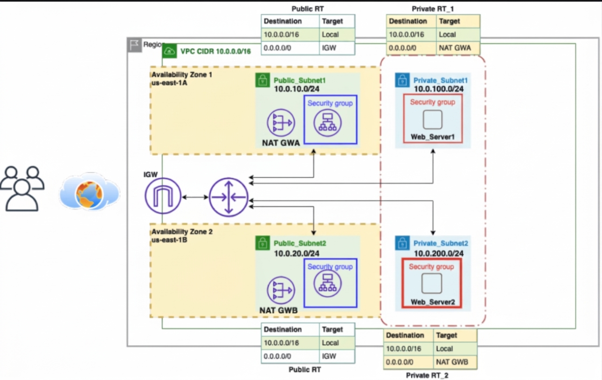

# Multi-Tier Web Application on AWS with Terraform

Terraform configuration for deploying a small, highly available web application across two Availability Zones in AWS. An internet-facing Application Load Balancer serves HTTP traffic to Amazon Linux EC2 instances in private subnets. The instances are managed by an Auto Scaling Group and run Apache to serve the included sample page.

## Architecture



The deployment includes:

- A VPC with two public and two private subnets in `us-east-1`.
- An Internet Gateway and public route table for the public subnets.
- A NAT Gateway and Elastic IP in each public subnet, with a separate private route table for each private subnet.
- An internet-facing Application Load Balancer in the public subnets, accepting HTTP on port 80.
- An EC2 Auto Scaling Group in the private subnets, initially running two instances and scaling between two and four instances.
- An Application Load Balancer target group with HTTP health checks. A target-tracking policy aims for 67% average CPU utilization.
- Security groups that allow public HTTP traffic to the load balancer and allow the load balancer to reach instances on port 80.
- An Amazon Linux 2023 x86_64 AMI and `t3.micro` launch template. User data installs Apache and writes the included `index.html` to the web root.

## Requirements

- An AWS account with permissions to create the resources listed above.
- Terraform `>= 1.0` and the AWS provider `~> 6.0`.
- AWS credentials configured through the standard AWS credential chain, such as an AWS CLI profile or environment variables.

The AWS provider region is currently set to `us-east-1` in `main.tf`. The Availability Zones are also explicitly set to `us-east-1a` and `us-east-1b`.

## Deploy

From the repository directory, configure AWS credentials and run:

```bash
terraform init
terraform validate
terraform plan
terraform apply
```

Review the plan before applying. Terraform will prompt for confirmation unless you pass `-auto-approve`.

After deployment, retrieve the load balancer's DNS name:

```bash
terraform output -raw DNS
```

Open `http://<DNS-name>` in a browser to view the sample application.

## Customize

- Edit `index.html` to change the page served by Apache.
- Edit the resources in `main.tf` to change the AWS region, Availability Zones, instance type, subnet CIDRs, scaling settings, or other infrastructure defaults.

## Clean up

When you no longer need the deployment, remove the AWS resources created by this configuration:

```bash
terraform destroy
```

Review the proposed deletions and confirm when prompted.

## Cost and security notes

- This configuration creates billable AWS resources. In particular, the two NAT Gateways, Application Load Balancer, and running EC2 instances can incur ongoing charges. Check current AWS pricing for your region and remove the deployment when finished.
- The load balancer is publicly reachable over HTTP (port 80); HTTPS and a TLS certificate are not configured.
- The EC2 instances are in private subnets and accept web traffic only from the load balancer's security group. Their outbound access uses the NAT Gateways.
- Terraform state can contain infrastructure details. Keep state files and credentials out of public repositories; this repository's `.gitignore` excludes local Terraform state and provider files.

## Repository contents

| File | Purpose |
| --- | --- |
| `main.tf` | AWS provider configuration and networking, load balancing, security, and compute resources |
| `outputs.tf` | Exposes the load balancer DNS name as `DNS` |
| `userdata.sh` | Installs Apache and writes the supplied page onto each instance |
| `index.html` | Sample page deployed by the instance startup script |
| `Architecture.jpeg` | Architecture diagram |
